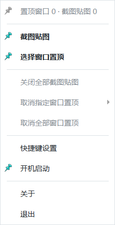
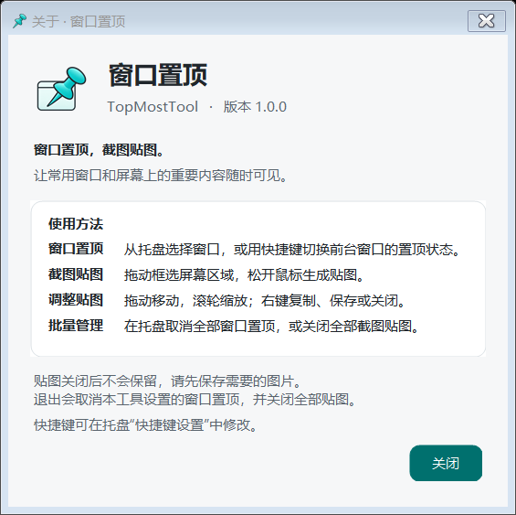

# TopMostTool


**窗口置顶，截图贴图。** 一个便携的 Windows 11 托盘工具，让常用窗口和屏幕上的重要内容随时可见。

[](https://github.com/shimushichen/TopMostTool/actions/workflows/ci.yml)
[](https://github.com/shimushichen/TopMostTool/releases/latest)
[](LICENSE)


[下载最新版本](https://github.com/shimushichen/TopMostTool/releases/latest) · [使用说明](#使用方法) · [开发与构建](docs/DEVELOPMENT.md) · [测试说明](docs/TESTING.md) · [更新记录](CHANGELOG.md)

## 下载

从 [Releases](https://github.com/shimushichen/TopMostTool/releases/latest) 下载：

- **TopMostTool.exe**：直接运行的单文件程序。
- **TopMostTool-1.0.0-win-x64.zip**：包含程序、使用说明和许可证的便携包。
- **SHA256SUMS.txt**：EXE 和 ZIP 的 SHA-256 校验值。

支持 Windows 11 x64，无需安装，也无需另行安装 .NET Runtime。更新前先从旧实例的托盘菜单选择 **退出**，再替换 EXE。

## 功能

- **窗口置顶**：一键切换当前窗口的置顶状态，也可从托盘点选窗口；标题栏显示跟随图钉。
- **截图贴图**：框选屏幕区域生成浮动贴图，支持拖动、缩放、复制原图和保存 PNG。
- **多图管理**：同时保留多张贴图，在托盘查看数量并批量关闭。
- **快捷键设置**：自定义窗口置顶和截图贴图组合键，检查冲突并在保存后生效。
- **托盘运行**：支持当前用户开机启动、单实例运行；退出时恢复本工具管理的窗口。
- **清晰图标与一致布局**：按 DPI 加载图标帧，主菜单与截图菜单共享样式，关于页可与贴图同时使用。

## 界面预览




预览取自控件渲染，原生窗口边框会随 Windows 主题变化。

## 使用方法

启动后，程序驻留在系统通知区域。右键图钉图标可打开菜单。

| 操作 | 默认快捷键 |
| --- | --- |
| 切换当前前台窗口置顶 | `Ctrl + Space` |
| 取消当前前台窗口置顶 | `Ctrl + Shift + Space`（固定） |
| 框选区域并生成截图贴图 | `Ctrl + Shift + S` |

窗口置顶和截图贴图的组合键可在 **快捷键设置** 中修改；若快捷键被其他软件占用，可使用托盘菜单。

截图后可使用：

| 操作 | 方法 |
| --- | --- |
| 移动贴图 | 拖动图片或工具栏空白区域 |
| 放大 / 缩小 | 滚轮、右键菜单、`Ctrl + +` / `Ctrl + -` |
| 重置缩放 | 点击百分比或按 `Ctrl + 0` |
| 复制原图 | 工具栏、右键菜单或 `Ctrl + C` |
| 保存原尺寸 PNG | 工具栏、右键菜单或 `Ctrl + S` |
| 关闭当前贴图 | 关闭按钮或 `Esc` |
| 批量管理 | 托盘的 **关闭全部截图贴图** / **取消全部窗口置顶** |

框选时按 `Esc` 或鼠标右键取消。菜单隐藏快捷键文字，按键功能仍可使用。没有可操作对象时，批量操作自动禁用。

## 数据与退出

截图在内存中保留，不上传，也不自动保存。**关闭贴图或退出程序前，请先保存需要的图片；未保存的贴图不会恢复。** 程序退出时会取消本工具设置的窗口置顶。

快捷键等设置保存在 `%AppData%\TopMostTool\config.json`。开机启动使用当前用户的 `HKEY_CURRENT_USER\Software\Microsoft\Windows\CurrentVersion\Run`，无需管理员权限。

## 从源码构建

需要 Windows 和 **.NET 8 SDK x64**，可使用 Visual Studio 2022 打开 `TopMostTool.sln`，或在仓库根目录运行：

```powershell
.\scripts\build.ps1
.\scripts\test.ps1 -Suite Surface -NoBuild
.\scripts\publish.ps1
```

发布脚本会先生成 staging EXE，再执行发布验证，通过后生成 `artifacts/release/v1.0.0/` 下的 EXE、便携 ZIP 和校验文件。已有实例需要先正常退出，验证脚本会拒绝干扰正在运行的实例。

图形界面及桌面交互回归需要已解锁的 Windows 桌面，详见 [测试说明](docs/TESTING.md)。离线构建、SDK 路径和图标再生成见 [开发说明](docs/DEVELOPMENT.md)。

## 项目结构

```text
TopMostTool.sln
src/TopMostTool/          应用源码与嵌入图标
tests/TopMostTool.Tests/  自包含回归测试程序
scripts/                 构建、验证、打包与图标工具
docs/                    开发、测试、发行说明和界面预览
.github/                 Windows CI、手动发行流程与反馈模板
```

## 已知限制

- 徽标通过窗口事件跟随第三方窗口，可能存在短暂的绘制延迟。
- 受保护内容、系统安全桌面及禁止截屏的应用可能无法正常捕获。
- 多显示器混合 DPI、复杂屏幕排列和系统深色主题仍需更多设备验证。
- 完整桌面回归中有一项物理鼠标拖动距离断言尚未稳定通过；已通过的专项和范围记录在 [测试说明](docs/TESTING.md)。

欢迎提交 [问题反馈](https://github.com/shimushichen/TopMostTool/issues) 或 Pull Request，参与前请阅读 [贡献说明](CONTRIBUTING.md)。本项目采用 [MIT 许可证](LICENSE)。
